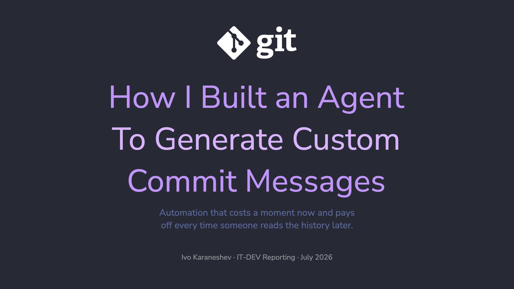

# Commit Messages, On My Terms

A presentation about building a configurable AI workflow for semantic commit message generation using Devin (formerly Windsurf).

---

**© 2026 Ivo Karaneshev · IT-DEV Reporting (California Squad)**  
Presented July 2026

---

## Overview

This deck tells the story of automating commit message generation while maintaining strict control over format and quality. Instead of relying on built-in tools, a custom workflow + rule system (in `.devin/workflows/` and `.devin/rules/`) lets you:

- Enforce your team's commit convention (`#TICKET - type(scope): title`)
- Keep meaningful git history (greppable, bisectable)
- Remove the friction of manual commit writing
- Stay in control of the output — it's all plain markdown, versioned with your code

The presentation covers the problem (lazy commit messages), the insight (LLMs are great at summarizing diffs), why existing solutions fall short, and how a simple rule + workflow system solves it.

**Presented on:** Dev Talks #2  
**Date:** July 2026  
**Theme:** [Dracula (custom fork with export fixes)](https://github.com/justivome/slidev-theme-dracula)

---

## Preview



---

## Running the presentation

### Prerequisites
- [Bun](https://bun.sh/) (or npm/pnpm)
- Node.js 16+

### View live
```bash
bun install
bun run dev
```
Then open <http://localhost:3030>

### Export to PDF/PNG
```bash
bun run export              # PDF to slides.pdf
bun run export --format png # PNGs to ./slides/
```

### Edit slides
Edit [slides.md](./slides.md) to modify the presentation. Changes auto-reload in the dev server.

---

Learn more about Slidev at the [documentation](https://sli.dev/).
