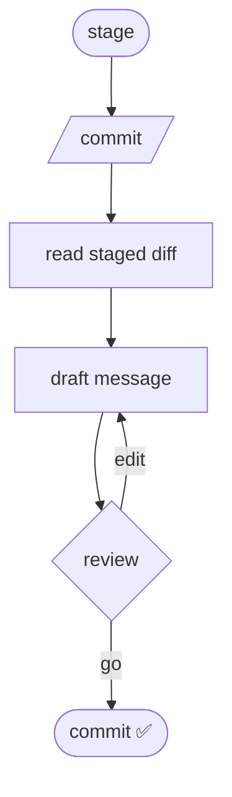

<div class="flex flex-col items-center justify-center text-center">


<h1 class="text-5xl">How I Built an Agent<br><span class="text-purple-300">To Generate Custom</span><br>Commit Messages</h1>

<p class="max-w-xl mx-auto text-balance leading-relaxed opacity-90">
Automation that costs a moment now and pays off every time someone reads the history later.
</p>

<div class="mt-6 text-sm opacity-50">
  Ivo Karaneshev · IT-DEV Reporting · July 2026
</div>

</div>

<!--
This is a short show-and-tell of a tiny workflow I built for Devin.
It asks an AI to write my commit messages for me — but in MY format, with MY rules.
A small idea, but it removed a step I used to do manually, every single time.
Let's start with why I bothered.
-->

---
layout: section
---

# 👨‍💻<br>The problem

<div class="opacity-70 mt-4">The one step I'm still typing manually, every single time.</div>

<!--
I'm a big fan of automation and AI-assisted development — it lets me finish work faster and focus
on the bigger picture. But the one part of the loop that stayed manual, every single time, was
writing the commit message. And I wasn't the only one.
-->

---

# The Backstory

Git hooks require every message to start with a ticket number before it reaches the remote.
<v-click>
For example <code>#CALI-3250</code>, <code>#PROSET-1234</code> or similar. 
</v-click>

<p v-after>
Everything after that is left to the developer.
</p>

<div class="grid grid-cols-2 gap-8 mt-8">
<div v-click>

```bash
$ git log --oneline
a1b2c3d  BS-100231 added changable bic, iban, ...
4d5e6f7  EXEREF-12087 fix: correct header and select...
8g9h0i1  CALI-3250 narrowinf disabled ...
```

<div class="text-sm opacity-80">
✅ Some of us heve good habits to write informative messages.
</div>

</div>
<div>

<div v-click>

```bash
$ git log --oneline
a1b2c3c  BS-100232 WIP
4d5e6f4  EXEREF-12088 fix
8g9h0i2  CALI-3251 update
```

<div class="text-sm opacity-80">
 <span>❌ But that is not always the case.</span>
</div>

</div>

</div>

<div class="col-start-2">
<v-clicks>

- 🔍 **Bisect & blame** turn into guesswork
- 👀 **Reviewers** lose the intent at a glance
- 🕰️ **Future-you**, three months on, has to ask why

</v-clicks>
</div>
</div>

<!--
This is a log most of us recognize. The ticket-number hook is satisfied, so the push goes through —
but "WIP" and "fix" tell a future reader nothing.
The cost isn't felt today. It's felt three months from now, bisecting a regression, or trying to
explain why a change was made. The information IS in the diff — we're just not writing it down.
-->

---
layout: section
---


# AI is _good enough_ for this

<div class="text-xl opacity-80 mt-6 max-w-2xl mx-auto">
Reading a diff and summarizing it is <span v-mark.circle.orange="1" >exactly</span> what an LLM is great at.
</div>

<!--
Here's the key insight. Summarizing a diff is squarely in the model's wheelhouse —
it's literally text-in, text-out summarization.
So the question isn't "can AI do it" — it can. The question is how do I remove the friction
AND keep control of the output format. Make the right thing the path of least resistance.
-->

---

# The built-in option

<div class="flex items-center gap-6 mt-2">
<div class="flex-1">

Devin already ships a **"Generate commit message"** ✨ button. 

<i>So why not just use it?</i>

</div>


</div>

<div class="grid grid-cols-2 gap-6 mt-6">
<div v-click class="p-4 rounded-lg border border-yellow-500/30 bg-yellow-500/5">

### ⚠️ It's in beta + documented limits

- "Large or complex commits may result in **more generic messages**"
- "Specialized **terminology** might not always be captured"
- "Generated messages are suggestions and **may need editing**"

</div>
<div v-click class="p-4 rounded-lg border border-red-500/30 bg-red-500/5">

### 🚫 The dealbreaker for me

- **Not configurable** - no custom format 
- No control over **types**, **ticket prefix**, or **guardrails**
- It's a black box that cannot be tuned

</div>
</div>

<div v-click class="mt-6 text-center opacity-70 text-sm">
Source: <a href="https://docs.devin.ai/desktop/ai-commit-message#limitations" target="_blank">docs.devin.ai — AI commit message · Limitations</a>
</div>

<!--
The obvious objection: Windsurf already has a sparkle button for this. I tried it.
It's fine! But it's beta, and their own docs list these limits — generic on big commits,
misses jargon, always needs a pass.
The real dealbreaker though is the last column: I can't make it follow my team's format.
No ticket prefix, no fixed type list. It's a black box. I wanted a glass box.
-->

---

# The Idea

<div class="grid grid-cols-2 items-center justify-between gap-6 mb-5">
<div>

The solution is quite small - **Workflow + Rule**.<br>
Two small markdown files that can be versioned.

</div>


<div>


```md
.windsurf/
├── rules/
│   └── commit-message.md   # always_on
│       → format, types,
│         ticket convention
└── workflows/
    └── commit.md           # /commit
        → stage-check, diff,
          review, commit
```

</div>

</div>

<v-click>

### Rule vs Workflow vs Skill

</v-click>

<v-clicks>

- 🧠 A **Rule** is a behavioral guideline - *always-on* context that shapes *how* AI behaves
- 🪜 A **workflow** is a prompt template for a *repeatable task* - triggered *manually*, on demand
- 🎯 A **Skill** is bundled procedure with supporting files - invoked *automatically* by AI,
based on context

</v-clicks>

<p v-click class="text-sm">

✅ *TODO* : turning <code>/commit</code> from a workflow into a <b>skill</b>, so Cascade can invoke it on its own.

</p>
<div v-click class="mt-6 text-xs text-center opacity-60">
 See Devin's <a href="https://docs.devin.ai/desktop/cascade/skills#skills-vs-rules-vs-workflows" target="_blank">Skills vs Rules vs Workflows</a>.
</div>

<!--
So here's what I built instead. Two markdown files.
One is a RULE — a behavioral guideline, always-on context that teaches the model my format, my
allowed types, my ticket convention. The other is a WORKFLOW — a prompt template for a repeatable
task, invoked manually with slash-commit: check staging, read the diff, propose, let me approve, commit.
Both are plain markdown in my repo. I can tweak them in seconds, and they're versioned with the project.
Longer term, I want to turn this workflow into a skill — Cascade's skills are folders that bundle
the procedure with supporting files and get invoked automatically based on context, instead of me
having to remember to type /commit every time.
-->

---

# The Rule

Defines the format, the allowed types, and the ticket convention.

Inspired by [Conventional Commits specification](https://www.conventionalcommits.org/en/v1.0.0/#summary)

```md {1|3-4}
#<ticket> - <type>(<scope>): <title>     ← lowercase title, ≤50 chars, no period

- optional bullet explaining the *why*
- another high-level point
```
<v-click>
<div class="mt-4 mb-2 text-sm opacity-70">Allowed types - a fixed, predictable set:</div>

<div class="grid grid-cols-2 gap-4 text-sm">
  <div>
  <span class="px-1 py-0.5 rounded bg-green-500/15 border border-green-500/30 mr-2">
    feat:
  </span>
  - New feature or functionality
  </div>
  <div>
  <span class="px-1 py-0.5 rounded bg-red-500/15 border border-red-500/30 mr-2">
    fix:
  </span>
  - Bug fix or correction
  </div>
  <div>
  <span class="px-1 py-0.5 rounded bg-purple-500/15 border border-purple-500/30 mr-2">
    refactor:
  </span>
  - Code restructuring or optimization, not fix or feature
  </div>
  <div>
  <span class="px-1 py-0.5 rounded bg-blue-500/15 border border-blue-500/30 mr-2">
    docs:
  </span>
  - Documentation changes
  </div>
  <div>
  <span class="px-1 py-0.5 rounded bg-yellow-500/15 border border-yellow-500/30 mr-2">
    test:
  </span>
  - Tests changes or additions
  </div>
  <div>
  <span class="px-1 py-0.5 rounded bg-pink-500/15 border border-pink-500/30 mr-2">
    chore:
  </span>
  - Non-user-facing changes - maintenance tasks, deps
  </div>
  <div>
  <span class="px-1 py-0.5 rounded bg-cyan-500/15 border border-cyan-500/30 mr-2">
    style:
  </span>
  - Code style changes
  </div>
  <div>
  <span class="px-1 py-0.5 rounded bg-orange-500/15 border border-orange-500/30 mr-2">
    perf:
  </span>
  - Performance improvements
  </div>
</div>
</v-click>

<div v-click class="mt-6 text-sm opacity-80">
On branch <code>CALI-3250</code>? → the message starts with <code>#CALI-3250</code> automatically. No copy-paste.
</div>

<!--
Here's the actual format the rule enforces. Ticket prefix, conventional-commit type and scope,
a lowercase title under 50 chars with no trailing period, and an optional body for the WHY.
The type list is fixed — eight options — so it's predictable and greppable.
And the nice touch: it pulls the ticket number straight from the branch name. I name branches
after the ticket anyway, so I never type the ticket again.
-->

---

# The Workflow

<div class="grid grid-cols-2 gap-10 mt-2 items-center">

<div>

The workflow is invoked with `/commit` from the Devin chat or Devin CLI.

<div class="flex flex-col gap-4 text-sm">
<div v-click class="p-3 rounded border border-purple-500/30 bg-purple-500/5">
🔒 <b>Never stages on its own</b><br/><span class="opacity-70">The staging is manually - only staged changes get committed</span>
</div>
<div v-click class="p-3 rounded border border-purple-500/30 bg-purple-500/5">
👀 <b>Always reviewable</b><br/><span class="opacity-70">Message shown in chat before anything is committed</span>
</div>
<div v-click class="p-3 rounded border border-purple-500/30 bg-purple-500/5">
🧹 <b>No AI ads</b><br/><span class="opacity-70">No "Generated with…" noise in history</span>
</div>
</div>
</div>

<div class="flex justify-center">



</div>

</div>

<!--
The flow itself. I stage what I want — deliberately, because staging IS my intent.
I run slash-commit. It reads only the staged diff, drafts a message using the rule,
and shows it to me in chat. I can ask for tweaks, or say "proceed" / "commit" / "go" and it commits.
Three guardrails I care about, along the bottom: it never stages for me — that's sacred, staging is intent.
It always shows me the message first. And no "Generated with AI" ad in my history.
-->

---

# Before → after

The same staged change, two separate outcomes:

<div class="relative h-6 mb-1 text-sm">
  <span class="absolute inset-x-0 transition-opacity duration-1200" :class="$clicks < 1 ? 'opacity-80' : 'opacity-0'">Before…</span>
  <span class="absolute inset-x-0 transition-opacity duration-1200" :class="$clicks === 1 ? 'opacity-80' : 'opacity-0'">What the workflow proposes instead…</span>
  <span class="absolute inset-x-0 transition-opacity duration-1200" :class="$clicks >= 2 ? 'opacity-80' : 'opacity-0'">…and optionally with a body.</span>
</div>

````md magic-move
```
WIP
```

```
#CALI-3250 - feat(auth): add JWT login flow
```

```
#CALI-3250 - feat(auth): add JWT login flow

- Implemented JWT token validation logic
- Added login form component
- Updated auth service methods
```
````

<div v-click class="text-xl mt-16 w-full grid place-items-center opacity-80">
<span>The effort is the same.</span>
<span>The payoff lands on every <span v-mark.green="4">future reader</span>.</span>
</div>

---

# What about credits? 💰

<div class="flex items-center gap-8 mb-4">


<div class="flex-1">

<v-clicks>

- 💳 `SWE-1.6` are free to use for now - pick either when drafting a message and it costs nothing
- ✅ Good enough for the job: summarizing a diff into a few lines
- 📉 Even outside the promotion, a commit message is a small amount of text

</v-clicks>

</div>

</div>


<v-click>

#### The cause

Routing goes through the Devin proxy, so the actual model identifier isn't exposed. 

<em>"Cascade, a coding assistant designed to help with development tasks in this workspace."</em>

</v-click>

<!--
A fair question in a corporate setting: does this quietly rack up usage?
Practically, no — SWE-1.5 and SWE-1.6 are free right now, and either is good enough for a
few lines of summary. Even without the promotion, this is a tiny amount of text.
The fun aside: because routing goes through the Devin proxy, I can't even tell you exactly which
model answers — it only ever identifies itself as "Cascade."
-->

---

# Comparison

<div class="text-sm">


|  | ✨ Devin's button | 🛠️ The workflow |
|---|---|---|
| **Format** (`#TICKET - type(scope)`) | ❌ not configurable | ✅ enforced by rule |
| **Ticket from branch** | ❌ | ✅ automatic |
| **Fixed type vocabulary** | ❌ | ✅ 8 defined types |
| **Reviewable before commit** | ⚠️ in the box | ✅ in chat, with edits |
| **Evolves with our convention** | ❌ fixed behavior | ✅ plain markdown, versioned |

</div>

<div v-click class="mt-6 text-center text-lg opacity-85">
The button ships with Devin's defaults. 

<span class="text-purple-300">This ships with our customizations then can be easily edited.</span>
</div>

<!--
Side by side. The button covers the happy path, but every row where I want control, it's a no.
Mine is yes across the board because it's just markdown I wrote.
The line I'd leave them with: the button ships with someone else's defaults. Mine ships with mine,
and it's a text file I can change whenever our convention changes.
-->

---
layout: statement
---

# Make the good commits <br/>and keep automating. 🚀

<div class="mt-12 opacity-60">
Thank you for your attention!
</div>

<div class="mt-6 text-sm opacity-50">
  Ivo Karaneshev · IT-DEV Reporting · July 2026
</div>

<!--
The takeaway: the trick isn't "use AI" — it's removing friction while keeping control, so the
good message becomes the easy one to write.
Two small markdown files did that for me. Steal them, adapt the format to your team's convention —
the hard part was never the code, it's deciding what a good commit message looks like for your
project. Once you have that, the workflow does the rest. Thank you.
-->
